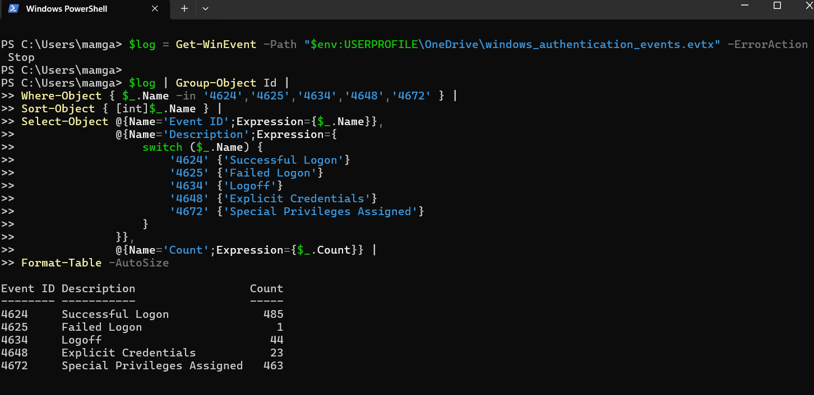
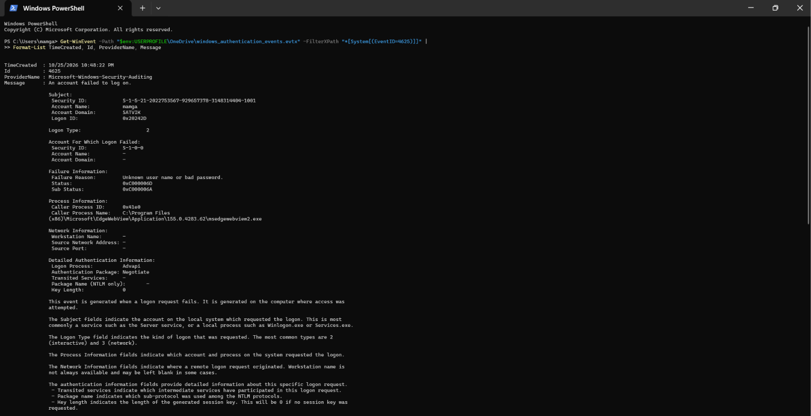
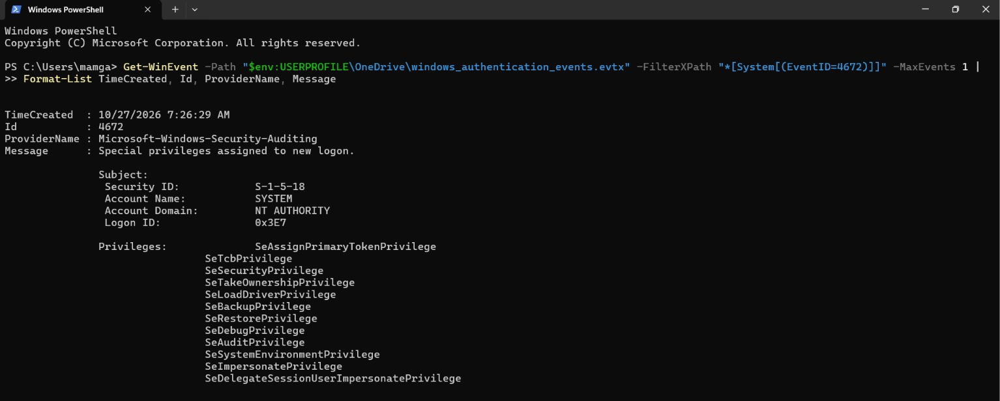

# Windows Authentication Events Investigation

## Project Overview

This project demonstrates a practical investigation of Windows Security Event Logs using Windows Event Viewer and PowerShell.

The objective was to analyse authentication-related events, identify failed login attempts, examine successful logons, and investigate privileged account activity.

The investigation simulates foundational tasks performed by a Security Operations Center (SOC) Analyst during authentication monitoring and incident triage.

## Lab Environment

| Component        | Details                            |
| ---------------- | ---------------------------------- |
| Operating System | Windows 11                         |
| Log Source       | Windows Security Event Logs        |
| Tools            | Windows Event Viewer, PowerShell   |
| Log Format       | .evtx                              |
| Exported File    | windows_authentication_events.evtx |

## Investigation Objectives

* Analyse Windows authentication events.
* Identify successful and failed login attempts.
* Investigate suspicious authentication patterns.
* Understand Windows Security Event IDs.
* Examine privileged account activity.
* Document findings and investigation conclusions.

## Event Log Analysis

The investigation focused on five important Windows Security Event IDs.

| Event ID | Description                              | Events Observed |
| -------- | ---------------------------------------- | --------------: |
| 4624     | Successful Logon                         |             485 |
| 4625     | Failed Logon                             |               1 |
| 4634     | Logoff                                   |              44 |
| 4648     | Logon Using Explicit Credentials         |              23 |
| 4672     | Special Privileges Assigned to New Logon |             463 |

These events provide visibility into authentication activity and privileged logon sessions.

## Investigation 1: Failed Login Attempt (Event ID 4625)

One failed authentication event was identified during the investigation.

### Observed Event Details

| Field          | Observed Value                    |
| -------------- | --------------------------------- |
| Event ID       | 4625                              |
| Date           | October 25, 2026                  |
| Time           | 10:48:22 PM                       |
| Account Name   | mamga                             |
| Account Domain | SATVIK                            |
| Logon Type     | 2                                 |
| Failure Reason | Unknown user name or bad password |
| Status         | 0xc000006d                        |
| SubStatus      | 0xc000006a                        |
| Process        | msedgewebview2.exe                |
| Source IP      | Not available                     |

### Technical Analysis

The event indicates an unsuccessful interactive logon attempt.

The status code 0xc000006d represents a general logon failure.

The substatus code 0xc000006a indicates an incorrect password.

The associated process was msedgewebview2.exe, a component used by applications that embed Microsoft Edge web content.

### SOC Analyst Assessment

This event warrants investigation, but it does not independently establish malicious activity.

Possible explanations include:

* An application attempting to authenticate with outdated credentials.
* An incorrect password entered during an authentication process.
* A legitimate application or Windows component triggering an unsuccessful logon.

Additional investigation would be required to establish the cause.

## Investigation 2: Privileged Logon Activity (Event ID 4672)

Event ID 4672 records special privileges assigned to a new logon session.

A total of 463 events were identified.

### Observations

* Most observed entries were associated with the SYSTEM account.
* 440 entries were associated with Logon ID 0x3e7.
* These entries primarily showed Logon Type 5 (service logon).
* Privilege information included SeAssignPrimaryTokenPrivilege and SeSecurityPrivilege.
* Additional entries were associated with user logon sessions, including Logon Types 7 and 11.

### SOC Analyst Assessment

Event ID 4672 is not inherently suspicious.

SYSTEM accounts and Windows services routinely require elevated privileges to perform operating system functions.

However, unexpected privileged logons, unusual account activity, or privilege assignments outside normal operating patterns should be investigated.

## Investigation 3: Successful Logons (Event ID 4624)

A total of 485 successful logon events were identified.

Event ID 4624 records successful authentication sessions.

These events provide useful information about:

* Account names.
* Logon types.
* Logon IDs.
* Authentication processes.
* Session activity.

Successful logons should be correlated with failed attempts and privileged logon events when investigating potentially suspicious authentication patterns.

## Investigation 4: Logoff Events (Event ID 4634)

A total of 44 logoff events were identified.

Event ID 4634 indicates that a logon session was terminated.

These events can help analysts understand session activity and correlate authentication events with session termination.

## Investigation 5: Explicit Credential Usage (Event ID 4648)

A total of 23 events were identified.

Event ID 4648 indicates that a process attempted to log on using explicitly supplied credentials.

This activity can be legitimate, including scheduled tasks and administrative operations.

However, unexpected use of explicit credentials may warrant further investigation.

## Key Findings

| Finding                    | Observation                                         |
| -------------------------- | --------------------------------------------------- |
| Successful authentication  | 485 events                                          |
| Failed authentication      | 1 event                                             |
| Logoff activity            | 44 events                                           |
| Explicit credential usage  | 23 events                                           |
| Privileged logon activity  | 463 events                                          |
| Failed login investigation | Incorrect-password substatus identified             |
| Privileged activity        | Predominantly associated with SYSTEM service logons |

## Investigation Conclusion

This lab provided practical exposure to Windows Security Event Log analysis and authentication investigation.

The investigation demonstrated how SOC analysts can use Windows Event IDs to examine authentication activity, investigate failed logons, understand privileged sessions, and identify events requiring further analysis.

The failed authentication event indicated an incorrect password, while the privileged logon analysis showed substantial SYSTEM-related service activity.

No confirmed malicious activity was established from the available evidence.

Further correlation with additional security telemetry would be necessary before determining whether any activity represented a genuine security incident.

## Skills Demonstrated

* Windows Security Event Log Analysis
* Windows Event IDs: 4624, 4625, 4634, 4648 and 4672
* Authentication Investigation
* Failed Login Analysis
* Privileged Account Monitoring
* PowerShell
* Incident Triage
* Security Documentation
* SOC Investigation Fundamentals

## Project Limitations

* Investigation was conducted on a personal Windows 11 environment.
* The available dataset represents activity captured from that environment.
* A single failed login event is insufficient to establish brute-force activity.
* Event ID 4672 does not independently indicate malicious privilege escalation.
* No dedicated enterprise SIEM was used in this project.

## Repository Structure

```text
windows-authentication-investigation/
│
├── README.md
│
├── screenshots/
│
├── evidence/
│
└── investigation/
```

## Disclaimer

This project was conducted in a personal lab environment for educational and cybersecurity portfolio purposes.

The findings represent observations from the available Windows Security Event Logs and should not be interpreted as confirmation of a security breach.

## Investigation Evidence

The following screenshots document the key stages of the investigation.

### 1. Windows Event ID Summary



Displays the observed counts for Windows authentication-related events.

### 2. Failed Authentication Investigation — Event ID 4625



Shows the investigated failed authentication event, including the account, logon type, status code, and process information.

### 3. Privileged Logon Investigation — Event ID 4672



Shows an example of a Windows privileged logon event and its assigned privileges.

## Detailed Investigation Report

For the complete technical investigation, observations, and SOC assessment, see:

[Windows Authentication Incident Report](investigation/incident-report.md)
